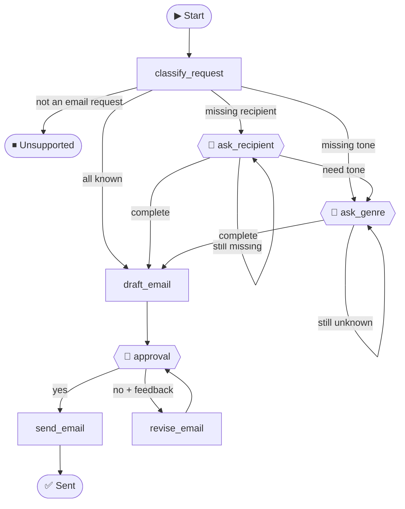

<div align="center">

# ✉️ Mail Agent CLI

**Your personal AI email assistant — right inside your terminal.**

Draft, review, refine, and send real emails through a conversational, human‑in‑the‑loop workflow.

[](https://www.python.org/)
[](https://langchain-ai.github.io/langgraph/)
[](https://aistudio.google.com/apikey)
[](#-license)

[Features](#-features) · [Quick Start](#-quick-start) · [Configuration](#-configuration) · [How It Works](#-how-it-works) · [Troubleshooting](#-troubleshooting)

</div>

---

## 🚀 What is this?

**Mail Agent CLI** turns a one‑line request into a polished, ready‑to‑send email — then lets *you* decide when it goes out.

```text
You ❯ Write a friendly email to alex@example.com thanking him for the project update
```

Instead of blindly sending, it pauses, shows you a **mail‑client‑style preview**, and waits for a `yes`… or feedback to rewrite it. Every revision stays in context, so you keep steering until the email sounds right.

> 🧠 Powered by **Google Gemini** for language, **LangGraph** for orchestration, and plain **SMTP** for delivery.

---

## ✨ Features

| | Feature | What it does |
|---|---|---|
| 🧭 | **Intent gating** | Recognizes email‑related requests and politely declines everything else. |
| 👤 | **Smart slot filling** | Extracts the recipient and tone from your sentence — and asks only for what's missing. |
| 🎭 | **Tone control** | Supports `professional`, `friendly`, `formal`, `casual`, `apologetic`, `persuasive`, `thankful`, `urgent` and more. |
| 🖥️ | **Mail‑client preview** | Renders the draft in a bordered, adaptive‑width box right in your console. |
| 🔁 | **Human‑in‑the‑loop revisions** | Reject with free‑text feedback; the agent rewrites while preserving what you liked. |
| ✍️ | **Consistent formatting** | Structured output guarantees a clean greeting, 2–4 short paragraphs, and a sign‑off. |
| 🛡️ | **Anti‑hallucination rules** | Never invents recipients, names, dates, or links; drops greetings for names you didn't give. |
| 📬 | **Direct SMTP delivery** | Gmail‑friendly, with STARTTLS/SSL support and actionable error messages. |
| 🎨 | **Polished terminal UX** | Colored prompts, spinners, Unicode boxes, and an ASCII fallback for old consoles. |

---

## ⚡ Quick Start

### 1. Clone & create a virtual environment

```bash
git clone <your-repo-url> mail-sender-cli
cd mail-sender-cli

python -m venv venv
```

**Activate it:**

```powershell
# Windows (PowerShell)
.\venv\Scripts\Activate.ps1
```

```bash
# macOS / Linux
source venv/bin/activate
```

### 2. Install dependencies

```bash
pip install -r requirements.txt
```

### 3. Configure your credentials

```bash
cp .env.example .env
```

Open `.env` and fill in at minimum:

- `GOOGLE_API_KEY` → [get one free from AI Studio](https://aistudio.google.com/apikey)
- `MAIL_USERNAME` / `MAIL_PASSWORD` → your address + an **App Password**
- `SENDER_NAME` → how you want to sign emails

> ⚠️ **Gmail users:** a normal password will **not** work. Enable 2‑Step Verification, then create an [App Password](https://myaccount.google.com/apppasswords).

### 4. Launch 🚀

```bash
cd app
python main.py
```

> 💡 `.env` is always loaded from the **project root** (one level above `app/`), even when packaged as an executable.

---

## 🕹️ Usage

Just describe what you want. The agent figures out the rest.

```text
You ❯ Draft a professional email to sarah@company.com about rescheduling Friday's demo

╭──────────────────────────────────────────────────────╮
│ ✉  EMAIL PREVIEW                                     │
├──────────────────────────────────────────────────────┤
│ To      : sarah@company.com                          │
│ Genre   : professional                               │
│ Subject : Rescheduling Friday's Demo                 │
├──────────────────────────────────────────────────────┤
│ Hi,                                                  │
│                                                      │
│ I'd like to reschedule our demo originally planned   │
│ for this Friday. Would early next week work for you? │
│                                                      │
│ Best,                                                │
│ Your Name                                            │
╰──────────────────────────────────────────────────────╯

Send this email? yes / no <feedback> ❯ no make it shorter and friendlier
```

**Approval cheat‑sheet**

| You type | Result |
|---|---|
| `yes`, `y`, `ok`, `send`, `approve` | 📤 Sends the email |
| `no <feedback>` | 🔁 Rewrites using your feedback, then asks again |
| `exit` / `quit` / `bye` | 👋 Ends the session (at any prompt) |
| `Ctrl+C` | 🛑 Cancels the current request |

**Example prompts**

```text
Write an apologetic email to mike@team.io for missing yesterday's standup
Compose a short, persuasive pitch to lead@startup.dev about our analytics tool
Send a warm thank-you note to priya@example.org for the introduction
```

---

## ⚙️ Configuration

All settings live in `.env` at the project root.

<details>
<summary><b>🤖 Gemini settings</b> (click to expand)</summary>

| Variable | Default | Description |
|---|---|---|
| `GOOGLE_API_KEY` | — | **Required.** Your Google AI Studio key. |
| `GEMINI_MODEL` | `gemini-2.5-flash` | Model used for parsing and drafting. |
| `GEMINI_API_VERSION` | `v1beta` | Must stay `v1beta` for structured/JSON output. |
| `GEMINI_MAX_OUTPUT_TOKENS` | `500` | Cap on generated tokens. |
| `GEMINI_THINKING_BUDGET` | `0` | Reasoning token budget (0 = fastest). |

</details>

<details>
<summary><b>📮 SMTP settings</b> (click to expand)</summary>

| Variable | Default | Description |
|---|---|---|
| `SMTP_HOST` | — | **Required.** e.g. `smtp.gmail.com`. |
| `SMTP_PORT` | `587` (`465` if SSL) | SMTP port. |
| `MAIL_USERNAME` | — | **Required.** Login / sender address. |
| `MAIL_PASSWORD` | — | **Required.** App Password (spaces are stripped automatically). |
| `MAIL_FROM` | `MAIL_USERNAME` | Envelope sender. |
| `SENDER_NAME` | — | Display name **and** email signature. |
| `MAIL_STARTTLS` | `True` | Upgrade a plain connection with STARTTLS. |
| `MAIL_SSL_TLS` | `False` | Use implicit TLS (port 465). |
| `SMTP_DEBUG` | `false` | Print the full SMTP conversation. |

</details>

<details>
<summary><b>📧 Other providers (examples)</b> (click to expand)</summary>

```ini
# Outlook / Microsoft 365
SMTP_HOST=smtp.office365.com
SMTP_PORT=587
MAIL_STARTTLS=True
MAIL_SSL_TLS=False

# Fastmail
SMTP_HOST=smtp.fastmail.com
SMTP_PORT=465
MAIL_STARTTLS=False
MAIL_SSL_TLS=True
```

</details>

---

## 🧠 How It Works

A **LangGraph** state machine drives the conversation. Nodes marked 🔶 pause the graph and wait for your input.



### The pipeline

1. **Classify** — regex intent check + email/tone extraction. No LLM needed for the gate.
2. **Clarify** — interrupt and ask the human only for what's missing; answers are parsed with structured output.
3. **Draft** — Gemini returns a typed `EmailDraft` (subject, greeting, paragraphs, closing, signature).
4. **Approve** — the same draft is rendered as a console preview.
5. **Revise / Send** — feedback loops back to the writer; approval hands off to SMTP.
6. **Checkpoint** — an `InMemorySaver` keeps the thread alive across every interrupt.

---

## 🗂️ Project Structure

```text
mail-sender-cli/
├── app/
│   ├── main.py         # CLI loop, prompts, spinners, interrupt handling
│   ├── ui.py           # Console rendering (email preview, success banner)
│   ├── graph.py        # LangGraph nodes, edges, conditional routing
│   ├── nodes.py        # LLM calls, prompts, SMTP sending, helpers
│   └── MailState.py    # TypedDict shared workflow state
├── .env.example        # Template configuration
├── requirements.txt    # Pinned dependencies
└── README.md
```

---

## 🩺 Troubleshooting

<details>
<summary><b>535 Bad Credentials / server disconnects during login</b></summary>

Gmail is rejecting your password. Fixes:

1. Turn on **2‑Step Verification**.
2. Generate a fresh **App Password** at [myaccount.google.com/apppasswords](https://myaccount.google.com/apppasswords).
3. Make sure `MAIL_USERNAME` is the **same** Google account.
4. Spaces in the App Password are ignored automatically — just paste it.

</details>

<details>
<summary><b>Connection refused / timeout on port 587</b></summary>

Some networks block 587. Switch to implicit TLS:

```ini
SMTP_PORT=465
MAIL_SSL_TLS=True
MAIL_STARTTLS=False
```

Set `SMTP_DEBUG=true` to see the full SMTP conversation.

</details>

<details>
<summary><b>Garbled box characters or missing colors</b></summary>

The UI auto‑detects UTF‑8 support and falls back to ASCII borders. On Windows, use **Windows Terminal** (or enable VT processing in `cmd`) for full color support. If text looks broken, try:

```powershell
$env:PYTHONUTF8=1
```

</details>

<details>
<summary><b>“I'm an email assistant…” for a valid request</b></summary>

The intent gate looks for words like *email, mail, draft, compose, send, reply, letter*… Include one of them, e.g. **“Draft an email about…”** instead of “Tell Alex about…”.

</details>

<details>
<summary><b>Missing quoting in `pip install` on Windows</b></summary>

Run commands from **PowerShell** (not the legacy `cmd`), and make sure the venv is activated — `python -m pip install -r requirements.txt` is the most reliable form.

</details>

---

## 🗺️ Roadmap

- [x] Conversational slot filling (recipient + tone)
- [x] Human‑in‑the‑loop revisions
- [x] Rich console preview
- [x] SMTP delivery with provider‑aware errors
- [ ] Persistent checkpoints (SQLite) across restarts
- [ ] CC / BCC and attachments
- [ ] HTML email bodies
- [ ] `--dry-run` mode
- [ ] Packaged single‑file executable

---

## 🤝 Contributing

Contributions are welcome!

```bash
git checkout -b feature/your-idea
# make changes
black app/
git commit -m "feat: your idea"
git push origin feature/your-idea
```

Keep it simple: clear names, small functions, and no secrets in commits (`.env` is already git‑ignored).

---

## 📄 License

Released under the **MIT License** — use it, fork it, improve it.

<div align="center">

**Built with ❤️ for people who hate writing emails.**

⭐ If this saved you five minutes, star the repo!

</div>
